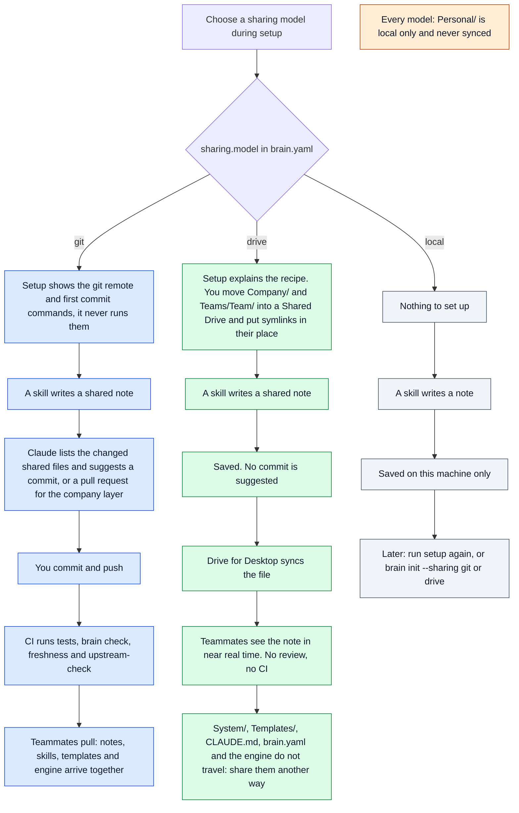

# Sharing models

## For future agent
This note explains what actually happens when a brain uses each sharing model in `brain.yaml` (`git`, `drive`, `local`): what setup does, what happens after a write, what travels to teammates and what does not. It describes the engine as built, including the parts of `drive` mode that are manual, so read it before recommending a model or setting one up. The rules themselves live in [[Layers and privacy]] and `.company-brain/references/layers.md`; if this note and the code ever disagree, check `.company-brain/scripts/brain.py` and the skills, then update this note.

## In one paragraph
The sharing model is one setting, `sharing.model` in `brain.yaml`, chosen in `/company-brain:setup` or with `brain init --sharing <git|drive|local>`. Changing it changes how the skills finish a write (suggest a commit, or just save); it does not move any files. `git` is the default and the recommended model: notes, skills, templates and the engine travel together, with review for company changes and CI checks. `drive` lets people without git share notes through Google Shared Drive, but only `Company/` and `Teams/<Team>/` travel, and the folders are moved and linked by hand. `local` shares nothing. In every model, `Personal/` stays on the owner's machine.

## What happens in each model



## What `drive` mode does today

### What exists
- `/company-brain:setup` offers `git`, `drive` and `local`, and `brain init --sharing drive` writes the choice to `brain.yaml`.
- The engine reads notes through symlinked folders (`iter_md` in `.company-brain/scripts/brain.py`, `_walk_md` in `.company-brain/mcp/vault/vault_ops.py`). So `brain refresh`, `brain check` and `brain search` work when `Company/` and `Teams/<Team>/` are links into Drive.
- With `drive` set, the skills stop suggesting commits and pull requests and just save.

### What is manual
- Creating the Shared Drive folders, moving `Company/` and each `Teams/<Team>/` into them, and replacing the local folders with symlinks. The setup skill explains this (step 7) but nothing in the CLI does it.
- Getting everything else to each teammate: `System/`, `Templates/`, `CLAUDE.md`, `Home.md`, `brain.yaml` and the `.company-brain/` engine. Drive mode does not share them and the docs do not say how they should travel. In practice teammates still clone the repository or copy the folder, and an improved skill reaches them only when they get a fresh copy.

So `drive` mode in practice is a hybrid: git (or a copied folder) for the engine, Drive for the content.

### Warnings
- **Keep `Personal/` out of Drive.** If someone puts the whole brain folder in Drive instead of linking only the two shared folders, their personal layer syncs to everyone. Nothing checks for this.
- **In the hybrid, stop tracking the linked folders in git.** Git stores a symlink as a link to a path on your machine, so committing `Company/` as a symlink shares a path that is wrong for everyone else. Remove `Company/` and `Teams/` from the repository and add them to `.gitignore` before linking them.
- **Each teammate makes their own links**, pointing at their own Drive folder (on macOS, `~/Library/CloudStorage/GoogleDrive-<account>/Shared drives/<Shared drive>/`). On Windows, creating symlinks needs Developer Mode or administrator rights.
- **Checks only run on Claude's writes.** The write hooks (layer guard, AI-first check, freshness) run when Claude writes. Edits made in Obsidian or the Drive web app are not checked until someone runs `brain check`. Git mode has CI as the backstop; Drive mode has none.
- **Conflicts are not detected.** When two people edit one file, or two people run `brain refresh` at the same time and both rewrite generated views, Drive may keep both versions as separate files. Nothing in `brain check` looks for them.

### The manual recipe (macOS example)
Run from the brain folder after reading the warnings above. `<account>` and `<Shared drive>` are yours.

```bash
DRIVE="$HOME/Library/CloudStorage/GoogleDrive-<account>/Shared drives/<Shared drive>"
mv Company "$DRIVE/Company" && ln -s "$DRIVE/Company" Company
mv "Teams/<Team>" "$DRIVE/<Team>" && ln -s "$DRIVE/<Team>" "Teams/<Team>"
./brain init --sharing drive
./brain check
```

Teammates do only the `ln -s` lines (without `mv`), pointing at their own Drive path, then `./brain check`.

## Git, drive and local compared

| | git | drive | local |
|---|---|---|---|
| Who can use it | people comfortable with git or the Obsidian Git plugin | anyone with Drive for Desktop | one person |
| How fast teammates see changes | when you push and they pull | near real time | never |
| Review before company changes | pull requests, with branch protection | none | not needed |
| Checks on edits made outside Claude | CI on every push | only when someone runs `brain check` | only when you run `brain check` |
| Skills, templates and engine updates | travel with the notes | do not travel | not shared |
| Permissions | the whole repository | per Drive folder | not shared |
| History | every line, any change can be undone | per file, limited | your own backups |
| Two people editing one file | git merge, usually clean thanks to per-person files | separate copies, not detected | not possible |
| Setup | `brain init`, then the remote commands Claude shows you | manual moves and symlinks | nothing |

### Git: pros
1. Company-layer changes go through a pull request, and branch protection can require it ([[Setup]], section 5).
2. CI runs `brain check`, `brain freshness`, the tests and `upstream-check` on every push, so edits made outside Claude are still checked.
3. Notes, skills, templates, `CLAUDE.md` and the engine are one versioned unit; a skill fix reaches teammates when they pull (they may also need to update the installed plugin).
4. `.gitignore` keeps `Personal/`, `Sources/`, `Exports/` and `.checkin.json` out of every commit.
5. Full history: who changed which line and when, and any change can be undone.
6. Per-person weekly files and generated views rebuilt by `brain refresh` keep most merges clean.
7. Nothing is shared until you commit and push, which matches promotion: shared on purpose.
8. Teammates are offered the plugin from the repository when they trust the folder ([[Setup]], section 5).

### Git: cons
1. Clone, commit, pull, push, pull requests and conflict resolution put off non-technical colleagues. The Obsidian Git plugin automates pull and push, but conflicts still reach the user.
2. Not real time: one person who forgets to push leaves everyone working from an old brain.
3. Claude never pushes, so every shared change waits for a person.
4. Read access is all or nothing: whoever can read the repository can read every team folder.
5. Everyone needs an account on the git host, which can mean per-person seats.
6. Shared files that are not per person (a team board, one objective note) can still conflict.
7. Google Docs stay outside the repository; the brain reads them as read-only pointers in every model.

## Choosing
- **Most writers can handle a pull request** (product, engineering, operations): use `git`. Review, CI and engine updates travelling with the notes are what keep the brain trustworthy.
- **Mixed teams**: use the hybrid that `drive` mode implies. Git for `.company-brain/`, `System/`, `Templates/` and `CLAUDE.md`, kept by one or two people; Drive for `Company/` and `Teams/` so everyone can write. Follow every warning above.
- **Trying it alone**: start with `local` and switch later. Switching changes the setting only; set up the remote or the Drive links yourself.

## Proposed improvements (not built)
These would make `drive` a supported model rather than a recipe. They are proposals, not features:
- A `brain share --drive` command that moves and links the shared folders, untracks them in git, and records the Drive paths in `brain.yaml` so teammates can recreate the links.
- Sharing `System/`, `Templates/`, `CLAUDE.md` and `brain.yaml` through Drive too, or a documented way to update them.
- `brain check` errors for `Personal/` inside a synced folder and for duplicate conflict copies.
- A scheduled `brain check` to stand in for CI.
- Drive detection on Windows, not only `~/Library/CloudStorage` on macOS.

## Related
- [[Layers and privacy]]: the layer rules and the short version of the transports
- [[Setup]]: installing, sharing through git, onboarding a teammate
- [[How Company Brain works]]: the overview
