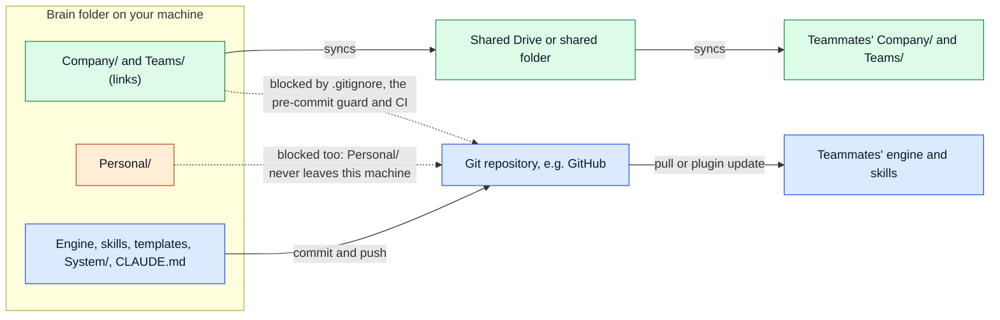

# Sharing models

## For future agent
This note explains how a brain reaches other people. There are two channels that never mix: content (`Company/`, `Teams/`) goes through a shared folder, chosen with `sharing.model` (`drive`, `folder`, `local`); the system (engine, skills, templates, docs) goes through git. It describes the engine as built: what `brain share` and `brain git` do, what the git guard refuses, how an older brain that shared notes through git moves over, and what is still manual. The rules themselves live in [[Layers and privacy]] and `.company-brain/references/layers.md`; if this note and the code ever disagree, check `.company-brain/scripts/brain.py` and the skills, then update this note.

## In one paragraph
A brain holds two kinds of files. **Content** is what the company writes into it: people, teams, meetings, goals, decisions, and `Company/company.yaml` with the company's name and settings. `Company/` and `Teams/` reach teammates through a Google Shared Drive (`drive`) or any other shared folder (`folder`), linked in by `brain share`; with `local` they stay on this machine. `Personal/` never leaves the machine in any model. The **system** is what makes every brain work: the `.company-brain/` engine and skills, `Templates/`, `System/`, `CLAUDE.md`, `Home.md` and the settings in `brain.yaml`. It travels through git, for example a GitHub repository, so improvements are versioned and reviewed. Git never carries content: `.gitignore` leaves it out, a pre-commit guard refuses it, and CI checks every tracked file.

## The two channels

| | Content | System |
|---|---|---|
| What | `Company/`, `Teams/` (every note about the company, its people, teams, meetings, goals, decisions), `Company/company.yaml`; on this machine only: `Personal/`, `Sources/`, `Exports/`, `index.md`, `log.md`, `brain.local.yaml`, `.checkin.json` | `.company-brain/` (skills, CLI, hooks, MCP server, specs, scaffold), `System/`, `Templates/`, `CLAUDE.md`, `Home.md`, `README.md`, `brain.yaml`, `.gitignore`, `.claude/`, `.claude-plugin/`, `.github/`, `.obsidian/` settings |
| Travels through | the shared folder (`sharing.model`); `Personal/` and local files go nowhere | git |
| How fast | as soon as the folder syncs | when someone commits, pushes and the others pull |
| Review | none: limit who can edit the company folder | pull requests and CI |
| Set up with | `brain share --to <folder>` | `brain init` installs the guard; commits with `/company-brain:contribute` or `brain git stage` |
| Settings | `Company/company.yaml` (shared), `brain.local.yaml` (this machine) | `brain.yaml` |



## Content: the sharing models

| | drive | folder | local |
|---|---|---|---|
| Where `Company/` and `Teams/` live | a folder in a Google Shared Drive, synced by Drive for Desktop | any folder everyone syncs or mounts: OneDrive, Dropbox, iCloud, a network share | on this machine |
| Who can use it | anyone with Drive for Desktop | anyone with that service | one person |
| How fast teammates see changes | near real time | as fast as the service syncs | never |
| Permissions | per Drive folder | per the service | not shared |
| History | per file, limited | per the service | your own backups |
| Two people editing one file | separate conflict copies, not detected yet | the same | not possible |

The model is set per machine in `brain.local.yaml`, by `brain share` (or `brain init --sharing local`). Changing it moves nothing by itself.

### Share for the first time
Run from the brain folder. Pick a folder outside the brain: on macOS a Shared Drive folder is under `~/Library/CloudStorage/GoogleDrive-<account>/Shared drives/<Shared drive>/`.

```bash
./brain share --to "<shared folder>"
./brain share --to "<shared folder>" --yes
./brain check
```

The first command is a dry run. With `--yes`, `Company/` and `Teams/` move into the shared folder and are replaced by links, and `brain.local.yaml` records the model (`drive` inside Google Drive, otherwise `folder`) and the folder. `Personal/` is not touched. `./brain share` with no `--to` shows the current state.

### A teammate joins
1. Get the system: clone the git repository (or copy the brain folder without `Company/`, `Teams/` and `Personal/`) and install the plugin ([[Setup]]).
2. Link the shared content before anything else, with their own path to the same shared folder: `./brain share --to "<shared folder>"`, then `--yes`. If they already have a local `Company/` or `Teams/` (for example from an earlier `brain init`), the shared copy wins and theirs moves to `.share-backup/`, with a count of files that differ, so nothing is lost and nothing is published by accident.
3. Run `/company-brain:setup`, which creates only their `Personal/` layer and their shared profile, then `./brain connect --sync` for shared sources.

### Warnings
- **Keep the brain folder itself out of synced folders.** Only `Company/` and `Teams/` belong in the shared folder. `brain share` refuses a target that contains the brain, and `brain check` reports `Personal/` inside the shared folder as an error and inside any cloud-synced folder as a warning.
- **Each teammate makes their own links**, pointing at their own path to the shared folder. On Windows, creating links needs Developer Mode or administrator rights.
- **No review for content.** A shared folder has no pull request. Skills show a diff and wait for a yes before changing a company note, but edits made in Obsidian or the Drive web app are only checked when someone runs `brain check`.
- **Conflicts are not detected yet.** When two people edit one file at once, or both run `brain refresh`, the sync service may keep both versions as separate files. Per-person weekly files and generated views (rebuilt by `brain refresh`) keep this rare.

## System: git
Git carries the system only. A commit may hold the system paths listed above, plus any path in `git.allow` in `brain.yaml` (which can never add a content path). Everything else is refused.

### What the guard checks
`brain init` installs a pre-commit hook in a git repository (or run `./brain git hook`). It runs `./brain git check --staged` and refuses the commit when the staged changes:
- add or change anything in `Company/`, `Teams/`, `Personal/`, `Sources/`, `Exports/`, or the local files (`index.md`, `log.md`, `brain.local.yaml`, `.checkin.json`, Obsidian workspace files);
- add a path that is not a system path;
- put a content note (`type: meeting`, `person`, `objective`, `decision` and the like) in `System/` or at the root, or in `Templates/` without template syntax;
- add lines to system files that contain the company's name, a person's full name from `Company/Org/People/`, a link to a company note, or a path into a real team's folder or to a content note.

Deleting tracked content always passes: that is how content leaves git. CI runs `./brain git check --tracked`, which fails when any tracked file is not a system path, so content cannot arrive by a commit that skipped the hook.

### Committing a system change
Ask Claude (`/company-brain:contribute`), or:

```bash
./brain git status
./brain git stage
git commit -m "<what changed in the system>"
```

`brain git status` splits the changes by channel; `brain git stage` adds every changed system file and nothing else, then runs the guard. Avoid `git add -A`, `git add .` and `git commit -a` in the brain. Claude never pushes or opens a pull request on its own.

### One engine for many brains
Because git holds no content, the same repository can serve as the engine for every brain in a company, and improvements can flow back to the public Company Brain product as pull requests without exposing anything about the company.

## Moving an older brain off git
Older brains used a `git` sharing model that committed `Company/` and `Teams/`. It is retired. To move:

1. **One person shares the content first**, so teammates keep getting it: `./brain share --to "<shared folder>" --yes`.
2. **Move the settings**: `./brain init`. It copies the company settings from `brain.yaml` into `Company/company.yaml`, sets `brain.local.yaml` (a `git` model becomes `local` until `brain share` runs), and leaves `brain.yaml` with system settings only.
3. **Take content out of git**, keeping the files on disk: `./brain git untrack`, then `--yes`. It also adds any missing content lines to `.gitignore`.
4. **Commit the result**: `./brain git stage`, then `git commit`. The commit removes content from git and passes the guard.
5. **Each teammate**: before pulling that commit, link the shared folder with `./brain share --to "<their path>" --yes`. The pull then removes git's copy of the notes, which is expected because the shared folder holds them now.

Git history still holds the old notes. If the repository is or will be public, rewriting history is a separate decision that needs everyone's agreement.

## Not built yet
- Detecting the duplicate files a sync service keeps when two people edit one note.
- A scheduled `brain check` to stand in for review on shared content.
- Google Drive detection outside macOS (`~/Library/CloudStorage`); on other systems, give the folder path to `brain share`.
- Restricting one team's folder to its members (planned in the roadmap as restricted teams).

## Related
- [[Layers and privacy]]: the layer rules and the short version of the two channels
- [[Setup]]: installing, sharing content, getting the system through git, onboarding a teammate
- [[How Company Brain works]]: the overview
