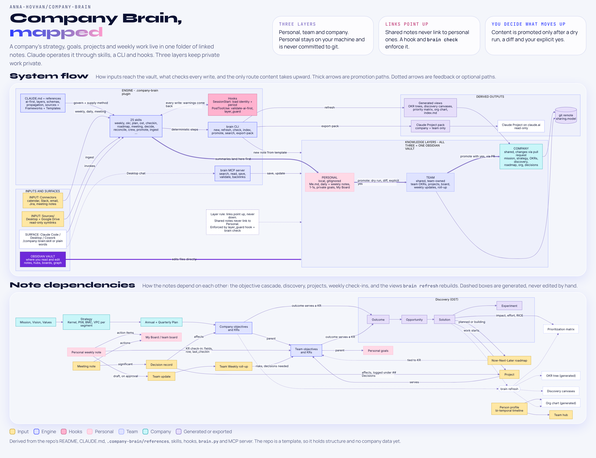

# Company Brain

An AI operating system for a company that lives in one folder. You browse and edit it in **Obsidian**. **Claude** operates it through a plugin with skills, hooks, an MCP server and a CLI. It shares knowledge in three layers: **personal**, **team** and **company**.

It's built on [obsidian-second-brain](https://github.com/eugeniughelbur/obsidian-second-brain), a single-person AI second brain, and extends it for multiplayer use. It also adds strategy and product frameworks: Value Proposition Canvas, Opportunity Solution Tree, Effort-Impact Matrix with RICE, OKRs, Strategy Kernel, Playing to Win, Business Model Canvas and Now-Next-Later roadmaps.


> **Open this folder as an Obsidian vault.** It is plain markdown: wikilinks, graph view, Dataview hubs and kanban boards work out of the box. See Quick start.

## What's inside

| Area | Where | What |
|---|---|---|
| Mission, vision, values | `Company/` | purpose statements with approval status and revision history |
| Strategy | `Company/Strategy/` | strategy kernel, Playing to Win, Business Model Canvas, one Value Proposition Canvas per segment |
| OKRs | `Company/OKRs/`, `Teams/<T>/OKRs/`, `Personal/Goals/` | annual and quarterly objectives, KRs with live progress fields, cascade via `parent:`, weekly check-ins, generated OKR trees |
| Planning | `*/Planning/` | annual and quarterly plans, operating cadence |
| Discovery | `*/Discovery/` | opportunity solution trees (outcome, opportunity, solution, experiment) rendered as Mermaid and as Obsidian canvases |
| Prioritization | `Company Prioritization`, `<Team> Prioritization` | generated effort-impact matrix and RICE ranking |
| Roadmap | `Company Roadmap`, `<Team> Roadmap` | Now / Next / Later kanban boards tied to key results |
| Organization | `Company/Org/`, `Teams/`, `Personal/Stakeholders/` | people profiles with bi-temporal history, org pages for customers, partners and vendors with their contacts, a People Directory of everyone by organisation (also as a live Obsidian table), who works on what (from project notes and from connected systems such as Linear, Jira and GitHub when the match is confident), personal stakeholder notes (what each person cares about, how you can help each other) and map, team charters, generated org chart |
| Projects, meetings, decisions | `*/Projects/`, `*/Meetings/`, `*/Decisions/` | in the layer they belong to |
| Weekly operating rhythm | `Personal/Daily/`, `Personal/Weekly/`, `Teams/<T>/Weekly/` | daily and weekly notes that pull from calendar, Slack, email, Jira, Drive and meeting notes; per-person team updates; team roll-ups |
| Index and graph | `Home.md`, hubs, `index.md` | every note links to what it serves, so the Obsidian graph reads as one network, colour-coded by layer |

## The tools

Around the notes sit the tools that run them: 32 Claude skills, five hooks that check every session and every write, the `brain` CLI, an MCP server for Claude Desktop chat, the views `brain refresh` builds from the notes, and the Obsidian vault with its templates, framework guides and community plugins.


## How Claude accesses it

| Surface | Read | Write | Notes |
|---|---|---|---|
| Claude Code (CLI, desktop app, Cowork) with the `company-brain` plugin | yes | yes | 32 skills: `/company-brain:weekly`, `:okr`, `:ost`, `:checkin`, `:reconcile`, `:prioritize`, `:roadmap`, `:meeting`, `:save`, `:find`, and more |
| Claude Code opened in this folder without the plugin (for example a claude.ai cloud session where company-brain is not an account or organization plugin) | yes | yes | the same `/company-brain:<name>` commands from `.claude/commands/company-brain/`; the session-start context and the after-write checks (AI-first, layer leaks, freshness) need the plugin, and only the guard on vendored files runs without it |
| Claude Desktop chat | yes | yes | through the brain MCP server (see `System/Setup.md`) |
| claude.ai Project | yes | no | read-only pack made by `/company-brain:export` (company and team layers only) |

Why plugin-first: a Claude Project can't read local files, run hooks or automate, so it's only a read-only window. The plugin is the operating layer.

## Multiplayer layers

- `Company/` and `Teams/<Team>/` are shared through a Google Shared Drive or another shared folder (`./brain share`), never through git.
- `Personal/` is yours. It never leaves your machine.
- Links go **up** the stack, never down. A hook and `brain check` stop shared notes from linking to personal ones.
- Moving content up is always deliberate (`/company-brain:promote`): private sections are stripped, you see a diff, and it's written only after you say yes.
- Each person's weekly update is its own file, so two people never edit the same file.

Details: `System/Layers and privacy.md` (human) and `.company-brain/references/layers.md` (spec).

## Content and system travel separately

| | Content | System |
|---|---|---|
| What | notes about the company, its people, teams, meetings, goals and decisions (`Company/`, `Teams/`, `Personal/`) and the company's settings (`Company/company.yaml`) | the engine, skills, templates, commands, `System/` docs, `CLAUDE.md`, `brain.yaml` |
| Travels through | a Google Shared Drive or other shared folder; `Personal/` stays local | git (this repository, or your fork) |

Git never carries content. `.gitignore` leaves it out, `./brain init` installs a pre-commit guard that refuses any commit holding content (or naming a person, the company or a company note in a system file), and CI runs `./brain git check --tracked`. So this repository holds placeholders only: `./brain init` creates `Company/` and `Teams/` on your machine from `.company-brain/scaffold/`. To contribute an improvement, use `/company-brain:contribute` or `./brain git stage`. Details: `System/Sharing models.md`.

## How it fits together

The top diagram shows how inputs, the Claude plugin and the three layers connect, and the only route content takes upward. The bottom one shows how the notes depend on each other, from mission down to weekly check-ins. Click the image for full size.

<a href="System/company-brain-map.png"></a>

## Quick start

1. **Obsidian**: open this folder as a vault, then enable the Dataview, Kanban, Templater and Calendar community plugins.
2. **Claude Code**:
   ```
   claude plugin marketplace add "/path/to/Company Brain"
   claude plugin install company-brain@company-brain
   ```
   Restart, open Claude in this folder, and run `/company-brain:setup`. It creates your `Company/`, `Teams/` and `Personal/` folders and, when you are ready, shares `Company/` and `Teams/` through a Shared Drive or shared folder.
   Without the plugin, Claude Code opened in this folder still has every skill under the same name (`/company-brain:setup`, `/company-brain:daily`, ...), from the project commands in `.claude/commands/company-brain/`.
3. **Sources**: `/company-brain:connect` mounts Desktop or Google Drive folders under `Sources/` (read-only symlinks).
4. **Rhythm**: `/company-brain:daily` each morning, `/company-brain:weekly` on Fridays, `/company-brain:plan quarterly` each quarter.

The `./brain` CLI works without Claude: `./brain period`, `./brain new objective --title ...`, `./brain promote <note> --to team`, `./brain refresh`, `./brain check`, `./brain freshness`, `./brain search`, `./brain share`, `./brain git status`, `./brain git stage`, `./brain export-pack`. Requirements: `python3` (the stock macOS one works), plus `uv` for the MCP server.

Tests: `python3 -m pytest .company-brain/tests` (needs `pytest`). CI runs them on every push and pull request, together with `./brain git check --tracked` (no content in git), `./brain freshness`, `./brain check --severity error`, `./brain upstream-check --verify` (vendored files unedited), `./brain commands --check` and `./brain scaffold-sync --check`.

After adding or editing a skill, run `./brain commands` to regenerate its slash command (`--check` only reports drift). To take in what obsidian-second-brain added or changed, run `/upstream-sync` in Claude Code (maintainers; it follows `.company-brain/references/upstream-sync.md`). New brains start from `.company-brain/scaffold/`. After editing `System/`, `Templates/`, `CLAUDE.md`, `Home.md`, or the slash commands here, run `./brain scaffold-sync` so new brains get the change (`./brain scaffold-sync --check` only reports drift). On macOS, `./brain scaffold-sync --watch` does this automatically in the background (launchd agent; `--unwatch` removes it).

To pick up improvements from obsidian-second-brain, run `./brain upstream-check`. It fetches the original repo and lists which of the files Company Brain borrowed (see `THIRD_PARTY_NOTICES.md`) changed since the commit recorded in `.company-brain/upstream.json`. `--diff` shows the changes, `--copy` takes the files we keep unchanged as they are, and after porting the adapted ones by hand `--mark` records the new commit; commit the result.

## Roadmap

`ROADMAP.md` holds an honest review of what Company Brain does well and where it falls short, and the plan that follows from it: access for non-technical users, automation, promotable notes and skills, large organizations and protection. The items are plans, not built features.

## Layout

```
Company Brain/
├── Home.md, CLAUDE.md, README.md, brain.yaml (system settings), brain (CLI)
├── brain.local.yaml  this machine's sharing setup (local, not in git)
├── Company/          company layer: shared folder, not in git (company.yaml holds the company's settings)
├── Teams/<Team>/     team layer: shared folder, team-owned, not in git
├── Personal/         personal layer (local only, not in git)
├── Sources/          symlinked Desktop and Google Drive folders (local, read-only)
├── System/           how it works, frameworks, skills, automations, setup
├── Templates/        Templater templates (also used by the CLI)
├── .company-brain/           the Claude Code plugin: skills, hooks, MCP server, CLI, specs, scaffolds
├── .claude-plugin/   marketplace manifest (source: ./.company-brain)
└── .obsidian/        vault settings (graph colours by layer, templates, daily notes)
```

## License

MIT, (c) 2026 Anna Hovhannisyan. See `LICENSE`.

The AI-first note rules, write validator and vault MCP server are vendored from obsidian-second-brain (MIT, (c) 2026 Eugeniu Ghelbur); see `THIRD_PARTY_NOTICES.md`. Obsidian community plugins are not included in this repository; each user installs them from Obsidian.
